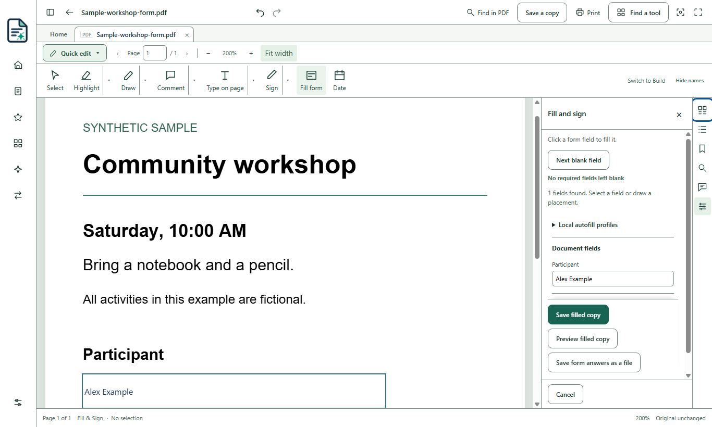

# PDFVEX / PDFix for Windows

PDFVEX is the new name for PDFix. Beta 3 still shows PDFix inside the app; the name changes there in Update 3.

**Read, mark up, fill and sign PDFs on your Windows PC.** PDFix is free and open source. Everyday PDF work can be done offline.

**Windows 10 and 11, 64-bit.** Beta 3 combines Updates 1 and 2. Beta 2 was skipped. Use the release page to see which builds are available.

[Downloads and SHA-256 checksums](https://github.com/DaringName1/pdfvex-pdfix/releases) · [Beta 3 notes](docs/release/RELEASE-NOTES-0.1.0-beta.3.md) · [Tester guide](docs/BETA-TESTER-GUIDE.md) · [Known issues](KNOWN-ISSUES.md)

En español: [Notas de la versión](docs/release/RELEASE-NOTES-0.1.0-beta.3.es.md) · [Guía de pruebas](docs/BETA-TESTER-GUIDE.es.md)

## Download and verify

1. Download the Windows Setup executable and its SHA-256 checksum from the same release.
2. Open PowerShell in the download folder. Replace the example filename with the exact one you downloaded:

   ```powershell
   Get-FileHash -Algorithm SHA256 -LiteralPath '.\PDFix-Setup-YYYY-MM-DD-COMMIT.exe'
   ```

   Compare all 64 characters under `Hash` with the checksum on the release page. If they differ, delete the download and download it again from Releases.
3. The installer is **unsigned**. Windows SmartScreen may show **Windows protected your PC**. If you trust the source and the checksum matches, **More info → Run anyway** lets you continue where Windows policy permits. A matching checksum checks the downloaded bytes against the posted copy.

## What works in Beta 3

- Open and search PDFs, highlight passages, draw, add comments, type on a page, and place a visual signature.
- Fill supported PDF fields and save a new copy. Start from **Fill and sign** on Home or from an open PDF. Supported Adobe Reader-extended forms include the English and Spanish IRS W-9, W-4 and 1040. Some copies lose Adobe Reader’s extra rights while keeping regular form fields.
- Fill or comment on PDFs that open without a password and allow the selected edit. The checked copy keeps the original encryption and permissions. See [known limits](KNOWN-ISSUES.md).
- Work beside the PDF in tools such as **Print**, **Combine PDFs**, **Bookmarks**, and **Review blank pages**.
- Enter English and Spanish in supported PDF editing tools. PDFix explains when entered characters are unsupported. **Make searchable** recognizes printed English and Spanish scans.
- Get clearer messages for many damaged files and pages the reader cannot display. Some protected, damaged files still show a technical message. **Save a copy** keeps the original file intact.

A highlight drag may occasionally fail to register. If no highlight appears, drag again. This is planned for Update 3.

Start with a sample or a copy of a document you can share. Open it, try **Comment** or **Fill form**, and choose **Save a copy**. Reopen the result to check it before relying on it.



[More screenshots from the candidate](docs/release/screenshots/README.md)

## Coming later

- Make highlight dragging more reliable and improve preview sizing.
- Keep existing comments, links and bookmarks when Organize rotates or removes pages.
- Show the PDFVEX name inside the app.
- Improve the message when a protected PDF forbids changes.
- Continue compatibility checks with other PDF viewers and a wider range of forms.

## Get help or contribute

Use [Issues](https://github.com/DaringName1/pdfvex-pdfix/issues) for bugs and suggestions. **Never upload personal, medical, financial, or confidential documents.** Use a synthetic example. Follow the [security reporting instructions](SECURITY.md) for a vulnerability.

[Contributing](CONTRIBUTING.md) · [Privacy](PRIVACY.md) · [Changelog](CHANGELOG.md)

PDFix is licensed under the **GNU General Public License, version 3 or any later version** (`GPL-3.0-or-later`). See [LICENSE](LICENSE) and [Third-party notices](THIRD-PARTY-NOTICES.md).

This project is not affiliated with PDFix, Inc. or its products.
